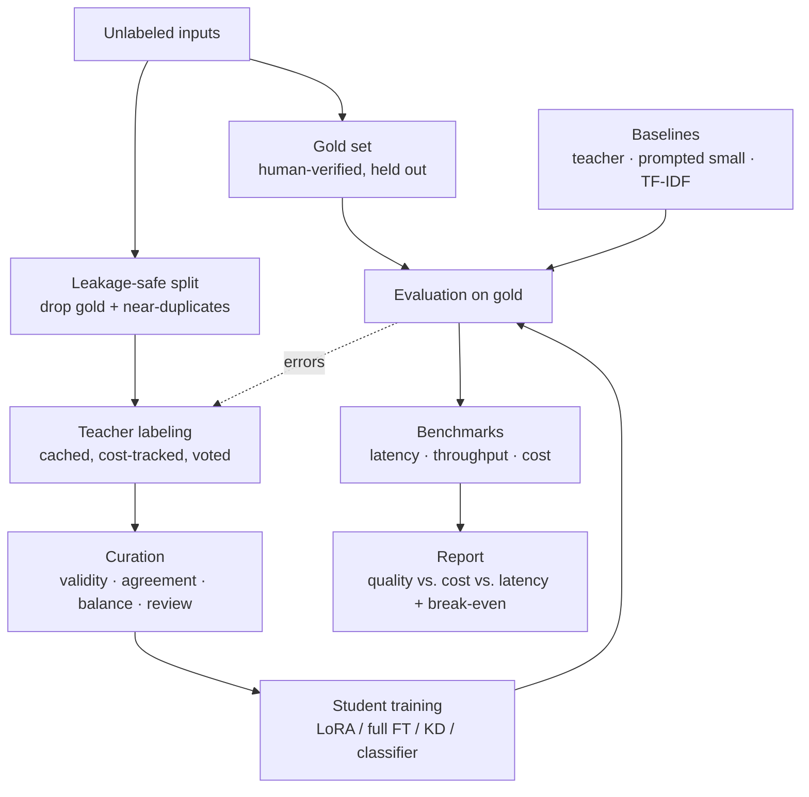

# LLM Distillation Lab

**Turn an expensive large-model API call into a small, fast, self-hosted model, then measure honestly whether it was worth it.**

This project is an end-to-end pipeline for **knowledge distillation**. A large "teacher" model (Claude, via the Anthropic API) labels thousands of inputs for one narrow task. A small open "student" model (Qwen2.5 0.5B–7B) is fine-tuned on those labels. The student is then compared with the teacher and with several baselines on **quality, latency and cost**, using a held-out, human-verified test set.

The output is a report that answers three questions:

1. **Quality:** how much of the teacher's accuracy does the student keep?
2. **Cost and latency:** how much cheaper and faster is it per 1,000 requests?
3. **Break-even:** at what request volume does the student pay for itself?

"It doesn't pay off" is a valid result, and the report is built to say so when it's true.

The example task is support-ticket classification (e.g. [Banking77](https://huggingface.co/datasets/mteb/banking77), 77 categories). The task is defined in a few files, so it can be swapped for another narrow task.

---

## Highlights

| Area | What's implemented |
|---|---|
| **LLM data generation** | Teacher labeling with disk caching, retries, cost tracking per call, and self-consistency voting across several samples |
| **Data quality** | Near-duplicate removal (TF-IDF cosine), train/test leakage protection, agreement-based filtering, class balancing, a human review queue for disputed labels |
| **Model training** | LoRA and full fine-tuning (TRL `SFTTrainer` + PEFT), white-box logit distillation with KL loss, rationale distillation, an encoder classifier (DistilBERT) |
| **Evaluation** | Accuracy and macro-F1 with bootstrap 95% confidence intervals, paired significance tests against the teacher, schema validity, calibration (ECE), robustness to perturbations, error analysis by cause |
| **Systems engineering** | Latency and throughput benchmarks against a vLLM server, a cost model, break-even analysis with sensitivity tables, a confidence-based student→teacher cascade |
| **Fair comparison** | Every student is compared with a prompted small model (same size, no training) and a TF-IDF floor, so a fine-tune never gets credit it didn't earn |

**Tech stack:** Python · PyTorch · Hugging Face Transformers, TRL, PEFT, Datasets · Anthropic API · vLLM · scikit-learn · pandas · Pydantic · pytest

---

## How it works



**Core idea:** the student is judged against **human-verified labels**, not just against the teacher. Matching the teacher alone would hide the teacher's own mistakes being copied.

---

## Quickstart

**Requirements:** Python 3.10+, an [Anthropic API key](https://console.anthropic.com/), and a GPU for student training (a free Colab GPU is enough for 0.5B–1.5B students).

```bash
git clone https://github.com/masudibnmusa/Llm-Distillation-Lab.git
cd Llm-Distillation-Lab

python -m venv .venv
source .venv/bin/activate          # Windows: .venv\Scripts\activate
pip install -r requirements.txt

cp .env.example .env               # then add ANTHROPIC_API_KEY (and HF_TOKEN if needed)
```

**Minimal run** (one student, end to end):

```bash
D="python -m distill.cli"

$D collect --hf mteb/banking77 --text-col text --label-col label_text --limit 10000
$D gold --n 300 --use-source-labels      # or `$D gold --n 300` to label by hand
$D split                                 # leakage-safe pool + train/val split

$D eval --system teacher                 # quality ceiling
$D eval --system prompted_small          # baseline to beat

$D label --samples 3                     # teacher labels the pool, 3-sample vote
$D curate --min-agreement 0.67
$D eval --system tfidf                   # sanity floor

$D train --student qwen-1.5b --config distill/student/configs/lora.yaml --tag qwen-1.5b
$D eval --system student --model qwen-1.5b

$D breakeven --gpu-hourly 1.0 --student-rps 20
$D report                                # writes data/runs/report.md
```

**Full run:** [`run.sh`](run.sh) adds a learning curve (500 → 5,000 training examples), robustness tests, the cascade sweep and latency benchmarks.

**Run the tests** (no GPU or API key needed):

```bash
pytest -q
```

---

## CLI reference

All commands run as `python -m distill.cli <command>`. Evaluations use the gold set unless `--file` is passed.

| Command | Purpose |
|---|---|
| `collect` | Gather unlabeled inputs from a Hugging Face dataset, JSONL or CSV |
| `synth` | Teacher-generated inputs to fill coverage gaps |
| `gold` | Build the human-labeled gold test set |
| `split` | Leakage-safe train/val split (drops gold and near-duplicates of gold) |
| `label` | Run the teacher over the pool (`--samples N` for self-consistency, `--rationales`) |
| `curate` | Filter, balance and format training data (`--review` to hand-label disputed examples) |
| `train` | Train a student: `--kind sft` (LoRA/full), `kd` (logit distillation), `classifier` (encoder) |
| `eval` | Evaluate `teacher`, `mid`, `prompted_small`, `tfidf`, `student` or `classifier` |
| `robust` | Accuracy under perturbations (typos, truncation, noise) and confidence on off-task inputs |
| `bench` | `latency` (sequential) or `throughput` (concurrent, against a vLLM server) |
| `breakeven` | Request volume where the student pays for itself, with a sensitivity table |
| `cascade` | Offline sweep of student→teacher routing thresholds: accuracy vs. cost |
| `report` | Build the quality vs. cost vs. latency summary |

---

## Systems compared

| System | Role |
|---|---|
| **Teacher** (Claude Sonnet 5.5 by default) | Quality ceiling and cost reference |
| **Student** (distilled Qwen2.5) | The system being evaluated |
| **Prompted small model** | Same base model as the student, few-shot prompt, no training: the baseline to beat |
| **Mid-tier model** (Claude Haiku 5.5) | A cheaper API option, to check whether distillation beats simply switching models |
| **TF-IDF + logistic regression** | Sanity floor, trained on the same teacher labels |
| **Cascade** | The student answers confident cases and sends the rest to the teacher |

If the prompted small model gets close to the student, the fine-tune isn't adding much. The report makes that visible.

---

## Project structure

```
distill/
├── cli.py              # single entry point for every pipeline step
├── config.py           # paths, models, prices, JSONL helpers
├── task/               # task spec, Pydantic output schema, prompts, scoring
├── data/               # input collection, gold builder, splitter, dedup, stats
├── teacher/            # API client (cache/retry/cost), labeler, voting, rationales, cost ledger
├── curation/           # validity/agreement filters, balancing, review queue, SFT formatting
├── student/            # SFT (LoRA/full), logit distillation, encoder classifier, model zoo
├── baselines/          # prompted small/mid models, TF-IDF baseline
├── evaluation/         # evaluator, metrics, significance, calibration, robustness, error analysis
├── benchmarking/       # latency, throughput, cost model, break-even
├── serving/            # LoRA merge + quantization, vLLM/Ollama serving, cascade router
└── reporting/          # markdown report and plots
notebooks/              # label inspection, error analysis
tests/                  # scoring, validity filter, splitter leakage, break-even
data/                   # created at runtime (git-ignored)
```

---

## Design decisions

- **Gold labels, not teacher agreement, are the measure of quality.** The gold set is never used for training or few-shot examples. The splitter also removes near-duplicates of gold items from the training pool, so scores aren't inflated by leakage.
- **Every result comes with a confidence interval.** Accuracy uses a bootstrap 95% CI. The gap to the teacher uses a *paired* bootstrap on the same examples, which tells you whether a difference is real or noise.
- **Teacher calls are cached and paid for once.** Responses are cached on disk by request content, so re-runs are free, and each paid call is logged to a cost ledger. Truncated or refused replies are not cached, so they get retried.
- **Noisy labels are filtered, not just piled up.** Self-consistency voting gives each label an agreement score. Low-agreement examples go to a human review queue instead of into training.
- **Cost is a range, not one number.** Break-even includes labeling, training GPU hours, hosting and (optionally) engineering time, and is reported across GPU prices and utilization levels.
- **Cascades need calibrated confidence.** The student's sequence probability is checked with reliability bins and ECE before it is used to route requests.

---

## Results

> **Not run yet.** This table will be filled in from `data/runs/report.md` after a full run.

| System | Accuracy (95% CI) | Schema validity | p50 latency | p95 latency | $/1k requests |
|---|---|---|---|---|---|
| Teacher | | | | | |
| Student (Qwen2.5-1.5B, LoRA) | | | | | |
| Prompted small | | | | | |
| TF-IDF | | | | | |
| Cascade | | | | | |

Success criteria for the example task are in [`distill/task/task_spec.md`](distill/task/task_spec.md): the student within 2 points of teacher accuracy, ≥ 99% valid outputs, p95 latency under 200 ms, and under 10% of the teacher's cost per 1k requests.

---

## Adapting it to a new task

1. Describe the task in `distill/task/task_spec.md`.
2. Set the label list in `data/labels.json` (`collect` writes it automatically when the source dataset has labels).
3. Adjust the prompts in `distill/task/prompt_templates.py` and the output schema in `distill/task/schema.py`.
4. Build a gold set of 200–500 human-verified examples before training anything.

Narrow tasks with a fixed output format work best: classification, routing, field extraction, fixed-format summaries. "Be a general assistant" doesn't distill well.

---

## Configuration

Set in `.env` (see [`.env.example`](.env.example)):

| Variable | Default | Purpose |
|---|---|---|
| `ANTHROPIC_API_KEY` | – | Teacher API access |
| `TEACHER_MODEL` | `claude-sonnet-5-5` | Model that labels the data |
| `MID_MODEL` | `claude-haiku-5-5` | Cheaper API baseline |
| `SMALL_BASELINE_MODEL` | `Qwen/Qwen2.5-1.5B-Instruct` | Prompted baseline; keep it equal to the student's base model |
| `GPU_HOURLY_USD` | `1.0` | GPU price used in the cost and break-even analysis |

Model prices live in `distill/config.py`. Check them against the provider's pricing page before reporting numbers.

---

## Known pitfalls this project guards against

- **The student copies the teacher's mistakes.** Measured with agreement split by whether the teacher was right or wrong.
- **Leakage between training and test data.** Handled by exact and near-duplicate removal against the gold set.
- **Unfair baselines.** A strong few-shot small model can make distillation unnecessary, so it's always included.
- **More data, diminishing returns.** The learning curve shows where quality levels off before more is spent on labels.
- **Measuring latency instead of throughput.** Real savings depend on batching, so throughput is measured under concurrency.
- **Terms of use.** Check that the teacher provider's terms allow training on its outputs, and that your input data may be sent to a third-party API. An open teacher (e.g. Qwen2.5-7B) avoids both and enables logit distillation.

---

## References

- Hinton et al., [*Distilling the Knowledge in a Neural Network*](https://arxiv.org/abs/1503.02531) (2015)
- Sanh et al., [*DistilBERT*](https://arxiv.org/abs/1910.01108) (2019)
- Hsieh et al., [*Distilling Step-by-Step*](https://arxiv.org/abs/2305.02301) (2023)
- Hugging Face [TRL](https://github.com/huggingface/trl), [PEFT](https://github.com/huggingface/peft) and [vLLM](https://github.com/vllm-project/vllm)

---

## Author

**Masud Ibn Musa** · [GitHub @masudibnmusa](https://github.com/masudibnmusa)

## License

MIT, see [LICENSE](LICENSE).
